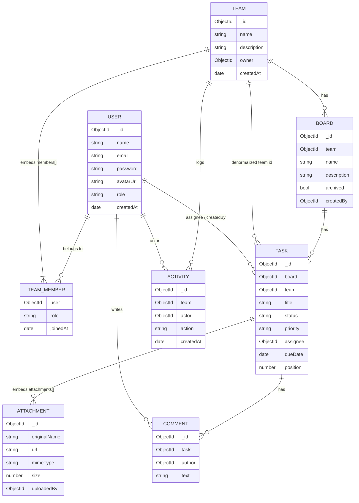

# Syncora: database design

Database: MongoDB (Atlas M0 in the cloud, `mongo:7` locally). ODM: Mongoose 8. Database name: `syncora`.

## 1. Entity relationship diagram



## 2. Embedding vs referencing (CHO unit 5)

| Relationship | Choice | Why |
|---|---|---|
| Team → members | **Embed** `members[]` | Small and bounded (a team has few people), always read with the team, needed on every access check |
| Task → attachments | **Embed** `attachments[]` | Bounded (cap 20 per task), only meaningful with the task |
| Team → boards | **Reference** (`board.team`) | Boards are listed and edited on their own |
| Board → tasks | **Reference** (`task.board`) | Unbounded; queried, filtered, paginated on their own |
| Task → comments | **Reference** (`comment.task`) | Unbounded; paginated separately |
| Task → team | **Reference + denormalized** (`task.team`) | Saves a lookup on every access check and lets team-wide aggregation skip a `$lookup` |
| Activity | **Separate collection** with TTL | Append-only log that expires |

Rule used: embed when the child is small, bounded and read together with the parent; reference when it grows without limit or is queried alone. MongoDB documents are capped at 16 MB, so unbounded arrays are a design bug.

## 3. Collections and schemas

Every schema uses `{ timestamps: true }` (adds `createdAt`, `updatedAt`) and `toJSON: { virtuals: true }`.

### 3.1 `users`

```js
const userSchema = new Schema({
  name:      { type: String, required: [true, 'Name is required'], trim: true, minlength: 2, maxlength: 60 },
  email:     { type: String, required: true, unique: true, lowercase: true, trim: true,
               match: [/^\S+@\S+\.\S+$/, 'Invalid email'] },
  password:  { type: String, required: true, minlength: 8, select: false },
  avatarUrl: { type: String, default: '' },
  role:      { type: String, enum: ['user', 'admin'], default: 'user' }, // platform role, not team role
  isActive:  { type: Boolean, default: true },
}, { timestamps: true });

// Mongoose middleware: hash before save
userSchema.pre('save', async function () {
  if (!this.isModified('password')) return;
  this.password = await bcrypt.hash(this.password, 10);
});

// Instance method
userSchema.methods.comparePassword = function (plain) {
  return bcrypt.compare(plain, this.password);
};

// Static method
userSchema.statics.findByEmail = function (email) {
  return this.findOne({ email: email.toLowerCase() });
};

// Hide password and __v in JSON output
userSchema.set('toJSON', { transform: (_doc, ret) => { delete ret.password; delete ret.__v; return ret; } });
```

Indexes: `{ email: 1 }` unique.

### 3.2 `teams`

```js
const memberSchema = new Schema({
  user:     { type: Schema.Types.ObjectId, ref: 'User', required: true },
  role:     { type: String, enum: ['owner', 'admin', 'member'], default: 'member' },
  joinedAt: { type: Date, default: Date.now },
}, { _id: false });

const teamSchema = new Schema({
  name:        { type: String, required: true, trim: true, minlength: 2, maxlength: 60 },
  description: { type: String, trim: true, maxlength: 500, default: '' },
  owner:       { type: Schema.Types.ObjectId, ref: 'User', required: true },
  members:     { type: [memberSchema], validate: [arr => arr.length <= 50, 'A team can have at most 50 members'] },
}, { timestamps: true });

teamSchema.methods.getRole = function (userId) {
  const m = this.members.find(x => x.user.equals(userId));
  return m ? m.role : null;
};

teamSchema.statics.forUser = function (userId) {
  return this.find({ 'members.user': userId }).sort('-updatedAt');
};

// Virtual: member count
teamSchema.virtual('memberCount').get(function () { return this.members.length; });

// Virtual populate: boards of this team (not stored)
teamSchema.virtual('boards', { ref: 'Board', localField: '_id', foreignField: 'team' });
```

Indexes: `{ 'members.user': 1 }` (multikey: "teams I belong to"), `{ owner: 1 }`.

Invariant enforced in the service: exactly one member has role `owner`, and it equals `team.owner`.

### 3.3 `boards`

```js
const boardSchema = new Schema({
  team:        { type: Schema.Types.ObjectId, ref: 'Team', required: true },
  name:        { type: String, required: true, trim: true, minlength: 1, maxlength: 80 },
  description: { type: String, trim: true, maxlength: 500, default: '' },
  color:       { type: String, match: /^#[0-9a-fA-F]{6}$/, default: '#6366f1' },
  archived:    { type: Boolean, default: false },
  createdBy:   { type: Schema.Types.ObjectId, ref: 'User', required: true },
}, { timestamps: true });

// Virtual populate with count
boardSchema.virtual('taskCount', { ref: 'Task', localField: '_id', foreignField: 'board', count: true });
```

Indexes: `{ team: 1, archived: 1, createdAt: -1 }`, unique `{ team: 1, name: 1 }` (no duplicate board names in a team).

### 3.4 `tasks`

```js
const STATUSES = ['todo', 'in_progress', 'done'];
const PRIORITIES = ['low', 'medium', 'high', 'urgent'];

const attachmentSchema = new Schema({
  originalName: { type: String, required: true },
  fileName:     { type: String, required: true },     // stored name (uuid + ext) or Cloudinary public_id
  url:          { type: String, required: true },
  mimeType:     { type: String, required: true },
  size:         { type: Number, required: true },     // bytes
  uploadedBy:   { type: Schema.Types.ObjectId, ref: 'User', required: true },
  uploadedAt:   { type: Date, default: Date.now },
});

const taskSchema = new Schema({
  board:       { type: Schema.Types.ObjectId, ref: 'Board', required: true },
  team:        { type: Schema.Types.ObjectId, ref: 'Team', required: true },
  title:       { type: String, required: [true, 'Title is required'], trim: true, minlength: 3, maxlength: 120 },
  description: { type: String, trim: true, maxlength: 2000, default: '' },
  status:      { type: String, enum: STATUSES, default: 'todo' },
  priority:    { type: String, enum: PRIORITIES, default: 'medium' },
  priorityRank:{ type: Number, default: 1 },            // 0 low .. 3 urgent, set in pre('validate'); makes ?sort=priority numeric
  assignee:    { type: Schema.Types.ObjectId, ref: 'User', default: null },
  dueDate:     { type: Date, default: null },
  labels:      { type: [String], validate: [a => a.length <= 10, 'At most 10 labels'], default: [] },
  position:    { type: Number, default: 0 },          // order inside a column
  attachments: { type: [attachmentSchema], validate: [a => a.length <= 20, 'At most 20 attachments'] },
  createdBy:   { type: Schema.Types.ObjectId, ref: 'User', required: true },
  completedAt: { type: Date, default: null },
}, { timestamps: true, toJSON: { virtuals: true } });

taskSchema.virtual('isOverdue').get(function () {
  return !!this.dueDate && this.status !== 'done' && this.dueDate < new Date();
});

// Keep completedAt in sync with status
taskSchema.pre('save', function () {
  if (this.isModified('status')) this.completedAt = this.status === 'done' ? new Date() : null;
});

// Cascade: deleting a task deletes its comments (document middleware)
taskSchema.pre('deleteOne', { document: true, query: false }, async function () {
  await mongoose.model('Comment').deleteMany({ task: this._id });
});

taskSchema.statics.STATUSES = STATUSES;
taskSchema.statics.PRIORITIES = PRIORITIES;
```

Indexes:

| Index | Serves |
|---|---|
| `{ board: 1, status: 1, position: 1 }` (compound) | Board view: tasks of a board by column in order |
| `{ assignee: 1, status: 1, dueDate: 1 }` (compound) | "My tasks", workload, due soon |
| `{ team: 1, dueDate: 1 }` | Team dashboard "due in 7 days", overdue |
| `{ title: 'text', description: 'text' }` with weights `{ title: 5, description: 1 }` | Search `?q=` |
| `{ board: 1, createdAt: -1 }` | Default sort on list |

Compound index order follows the **ESR rule**: Equality fields first (`board`, `status`), then Sort (`position`), then Range.

Verify with `explain('executionStats')` in Compass: look for `IXSCAN`, not `COLLSCAN`. Screenshot this for the report.

### 3.5 `comments`

```js
const commentSchema = new Schema({
  task:   { type: Schema.Types.ObjectId, ref: 'Task', required: true },
  team:   { type: Schema.Types.ObjectId, ref: 'Team', required: true },
  author: { type: Schema.Types.ObjectId, ref: 'User', required: true },
  text:   { type: String, required: true, trim: true, minlength: 1, maxlength: 1000 },
  edited: { type: Boolean, default: false },
}, { timestamps: true });
```

Index: `{ task: 1, createdAt: -1 }`.

### 3.6 `activities`

```js
const activitySchema = new Schema({
  team:   { type: Schema.Types.ObjectId, ref: 'Team', required: true },
  board:  { type: Schema.Types.ObjectId, ref: 'Board' },
  task:   { type: Schema.Types.ObjectId, ref: 'Task' },
  actor:  { type: Schema.Types.ObjectId, ref: 'User', required: true },
  action: { type: String, required: true, enum: [
    'team.created','team.updated','member.added','member.removed','member.role_changed',
    'board.created','board.updated','board.deleted',
    'task.created','task.updated','task.moved','task.deleted',
    'comment.added','attachment.added','attachment.removed' ] },
  meta:   { type: Schema.Types.Mixed, default: {} },  // e.g. { from: 'todo', to: 'done', title: '...' }
  createdAt: { type: Date, default: Date.now },
});
activitySchema.index({ team: 1, createdAt: -1 });
activitySchema.index({ createdAt: 1 }, { expireAfterSeconds: 60 * 60 * 24 * 90 }); // TTL: 90 days
```

## 4. Populate examples

```js
// Task with assignee and creator names only
Task.findById(id)
  .populate('assignee', 'name email avatarUrl')
  .populate('createdBy', 'name');

// Team with member user details
Team.findById(id).populate('members.user', 'name email avatarUrl');

// Boards of a team with task counts (virtual populate, count: true)
Board.find({ team: teamId, archived: false }).populate('taskCount');
```

Use `.lean()` on read-only list endpoints for speed (plain objects, no Mongoose document overhead). Note that `.lean()` drops virtuals unless you use the `mongoose-lean-virtuals` plugin, so compute `isOverdue` in the response mapper for lean lists.

## 5. Aggregation pipelines (CHO unit 5)

### 5.1 Board stats: `GET /api/boards/:boardId/stats`

```js
Task.aggregate([
  { $match: { board: boardId } },
  { $facet: {
      byStatus:   [ { $group: { _id: '$status', count: { $sum: 1 } } } ],
      byPriority: [ { $group: { _id: '$priority', count: { $sum: 1 } } } ],
      overdue:    [ { $match: { status: { $ne: 'done' }, dueDate: { $lt: new Date() } } }, { $count: 'count' } ],
      total:      [ { $count: 'count' } ],
  } },
]);
```

The service turns this into `{ total, byStatus: { todo, in_progress, done }, byPriority: {...}, overdue, completionRate }`.

### 5.2 Team workload: `GET /api/teams/:teamId/dashboard`

```js
Task.aggregate([
  { $match: { team: teamId, status: { $ne: 'done' } } },
  { $group: {
      _id: '$assignee',
      open: { $sum: 1 },
      overdue: { $sum: { $cond: [ { $and: [ { $ne: ['$dueDate', null] }, { $lt: ['$dueDate', new Date()] } ] }, 1, 0 ] } },
      urgent: { $sum: { $cond: [ { $eq: ['$priority', 'urgent'] }, 1, 0 ] } },
  } },
  { $lookup: { from: 'users', localField: '_id', foreignField: '_id', as: 'user',
               pipeline: [ { $project: { name: 1, email: 1, avatarUrl: 1 } } ] } },
  { $unwind: { path: '$user', preserveNullAndEmptyArrays: true } }, // null assignee = "Unassigned"
  { $sort: { open: -1 } },
]);
```

### 5.3 Completed per day (last 14 days), for a small chart

```js
Task.aggregate([
  { $match: { team: teamId, completedAt: { $gte: fourteenDaysAgo } } },
  { $group: { _id: { $dateToString: { format: '%Y-%m-%d', date: '$completedAt', timezone: 'Asia/Kolkata' } }, done: { $sum: 1 } } },
  { $sort: { _id: 1 } },
]);
```

`aggregate()` does not cast types, so convert ids yourself: `new mongoose.Types.ObjectId(boardId)`.

## 6. Cascade deletes

| Delete | Also deletes |
|---|---|
| Team | its boards, tasks, comments, activities, and attachment files on disk |
| Board | its tasks, their comments and files |
| Task | its comments (pre `deleteOne` hook) and files |

Run team and board cascades in a **transaction** (`session.withTransaction`) on Atlas (replica set), so a crash can't leave orphans. `utils/transaction.js` checks whether the server is a replica set and runs the same work without a session on a standalone `mongod`. Delete files after the transaction commits; a failed file delete is only logged.

## 7. Validation layers

1. **Request level** (express-validator): types, lengths, enums, ObjectId format, sanitizing (`trim`, `escape` on free text shown as HTML, `normalizeEmail`).
2. **Schema level** (Mongoose): `required`, `enum`, `min`/`max`, `match`, custom validators. This is the last line of defence for anything that bypasses routes (seed scripts, admin tools).
3. **Business level** (services): assignee must be a team member; only one owner; a board belongs to the task's team.

## 8. Custom errors from the data layer

| Situation | Error |
|---|---|
| `findById` returns null | `new AppError('Task not found', 404, 'NOT_FOUND')` |
| Bad ObjectId string | Mongoose `CastError` → 400 `INVALID_ID` |
| Duplicate email or board name | Mongo `E11000` → 409 `DUPLICATE` |
| Schema rule broken | `ValidationError` → 400 with per-field messages |

## 9. Seed data (`npm run seed`)

| Collection | Seed |
|---|---|
| users | `owner@syncora.dev` (also platform admin), `admin@syncora.dev`, `member@syncora.dev`, `outsider@syncora.dev`, `bansal@syncora.dev` (password `Password123`) |
| teams | "Syncora Core" with owner, admin, member; "Outsider Team" with outsider only |
| boards | "Sprint 1", "Report and Viva" |
| tasks | 12 tasks on "Sprint 1" across statuses and priorities (3 overdue, 2 unassigned, 1 with a PDF attachment), 4 on "Report and Viva", 1 private task in "Outsider Team"; done tasks get a back-dated `completedAt` for the chart |
| comments | 5 comments |

The seed script drops the database first and refuses to run when `NODE_ENV=production`.

## 10. Connection (`config/db.js`)

```js
const mongoose = require('mongoose');
const logger = require('../utils/logger');

mongoose.set('strictQuery', true);
mongoose.set('sanitizeFilter', true);

async function connectDB(uri) {
  await mongoose.connect(uri, { serverSelectionTimeoutMS: 10000 });
  logger.info(`MongoDB connected: ${mongoose.connection.host}`);
  mongoose.connection.on('error', err => logger.error('MongoDB error', { err }));
  mongoose.connection.on('disconnected', () => logger.warn('MongoDB disconnected'));
}
module.exports = connectDB;
```

The connection string lives only in `MONGODB_URI` in `.env`.
