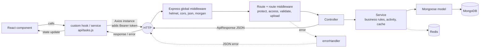
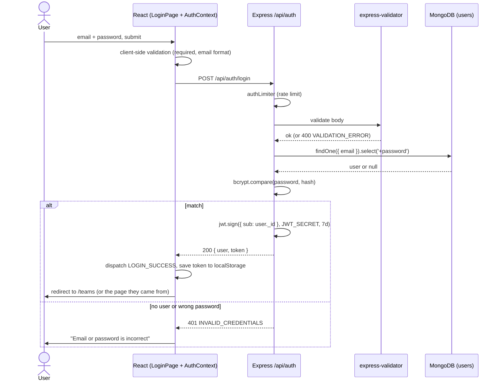
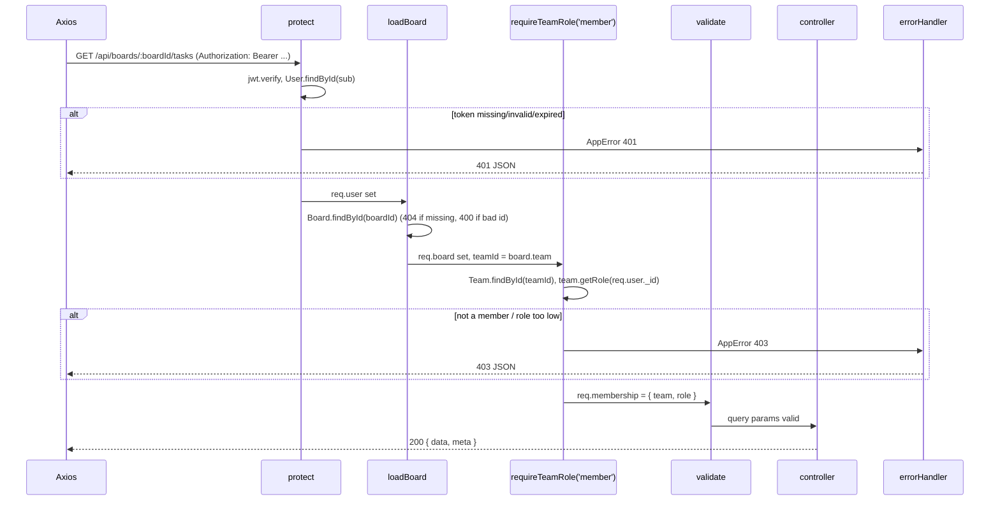
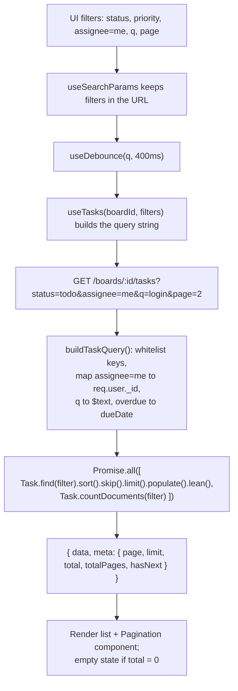
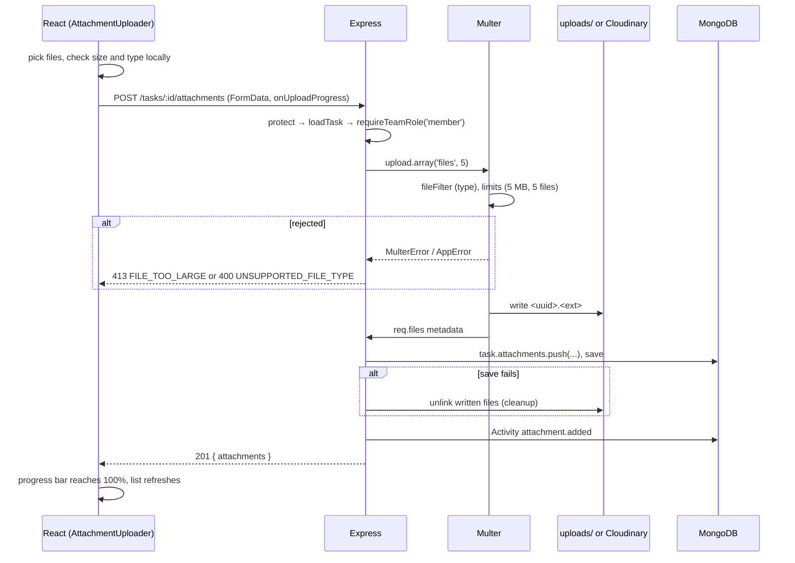
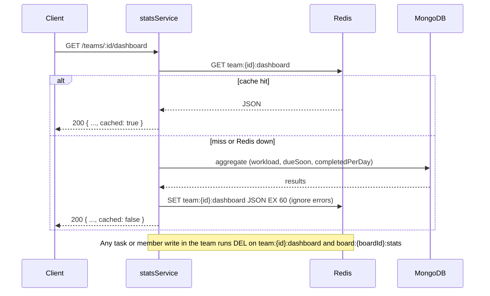

# Syncora: data flow

How data moves through the system for each key action. Each flow lists the steps, the files involved, and what can go wrong. The diagrams are Mermaid, which GitHub renders.

## 1. Big picture



## 2. Register and login



Files: `client/src/pages/LoginPage.jsx`, `context/AuthContext.jsx`, `api/auth.js`, `server/src/routes/auth.routes.js`, `validators/auth.validators.js`, `controllers/auth.controller.js`, `services/auth.service.js`, `models/User.js`.

Register is the same, except it checks the email isn't taken (409), and the password is hashed by the `pre('save')` hook.

## 3. App start: restoring the session

1. `AuthProvider` mounts and reads the token from `localStorage`.
2. If there's a token, it calls `GET /api/auth/me`.
3. 200: dispatch `SESSION_RESTORED`. 401: clear the token and dispatch `LOGOUT`.
4. While this runs, `status = 'checking'` and `ProtectedRoute` shows a full-page spinner instead of redirecting, so a refresh doesn't flash the login page.

## 4. Any protected request (the middleware chain)



On the client, the Axios **response interceptor** handles 401 globally: clear the token, dispatch `LOGOUT`, redirect to `/login?expired=1`.

## 5. Create a task

1. `CreateTaskModal` (controlled form) validates the title and due date locally.
2. `api.tasks.create(boardId, body)` → `POST /api/boards/:boardId/tasks`.
3. Server chain: `protect → loadBoard → requireTeamRole('member') → validate(createTaskRules) → taskController.create`.
4. `taskService.create`:
   - checks the assignee is in `team.members` (else 400),
   - sets `team = board.team`, `createdBy = req.user._id`,
   - sets `position` = (max position in that status column) + 1,
   - `Task.create(...)`, then populates `assignee` and `createdBy`,
   - writes an `Activity` (`task.created`),
   - deletes the cache keys `board:{id}:stats` and `team:{id}:dashboard` (ETE).
5. 201 with the task. The board page appends it to the To Do column and shows a toast.

## 6. Move a task (drag and drop or the status dropdown)

1. The UI updates the column **optimistically** (moves the card immediately) and remembers the previous state.
2. `PATCH /api/tasks/:taskId/move { status, position }`.
3. `taskService.move`:
   - in the target column, `$inc: { position: 1 }` for tasks at or after the new position,
   - sets the task's status and position (the `pre('save')` hook sets or clears `completedAt`),
   - logs `task.moved { from, to }`, and invalidates the caches.
4. On success, keep the optimistic state. On error, roll back to the saved state and show the error toast.

## 7. List tasks with filters, search and pagination



Filters live in the URL, so refresh, back and forward work and links are shareable.

## 8. Upload attachments



## 9. Dashboard with Redis cache-aside (ETE)



## 10. Add a member

1. Owner or admin types an email in `MembersPanel`.
2. `POST /teams/:teamId/members { email, role }`.
3. Service: find the user by email (404), check they aren't already a member (409), and only the owner may add an `admin` (403). Then `$push` to `members`, log `member.added`, clear the dashboard cache.
4. The new member sees the team in `GET /teams` the next time they load the page.

## 11. Delete a team (cascade)

1. Owner confirms in a dialog (types the team name).
2. `DELETE /teams/:teamId` → `requireTeamRole('owner')`.
3. Service in a transaction: collect the board ids, then the task ids and attachment file names; `deleteMany` comments, tasks, boards and activities; delete the team; commit.
4. After commit, delete the files (errors only logged) and the cache keys.
5. 200, the client navigates to `/teams` and refetches.

## 12. Error flow

```
throw new AppError('Assignee is not a member of this team', 400, 'VALIDATION_ERROR')
  -> asyncHandler catches -> next(err)
  -> errorHandler: logger.warn (4xx) or logger.error (5xx, with stack), with requestId
  -> res.status(400).json({ success:false, error:{ code, message, details }, requestId })
Client: Axios interceptor normalizes it to { status, code, message, details }
  -> forms show details[] next to fields; other errors become a toast; 401 logs out
```

## 13. Logging flow (ETE)

`request → requestId middleware (uuid) → morgan (http line) → winston (console + logs/combined.log) → errorHandler (logs/error.log with stack and requestId)`. The `requestId` is returned in error responses, so a user's error can be matched to the log line.
