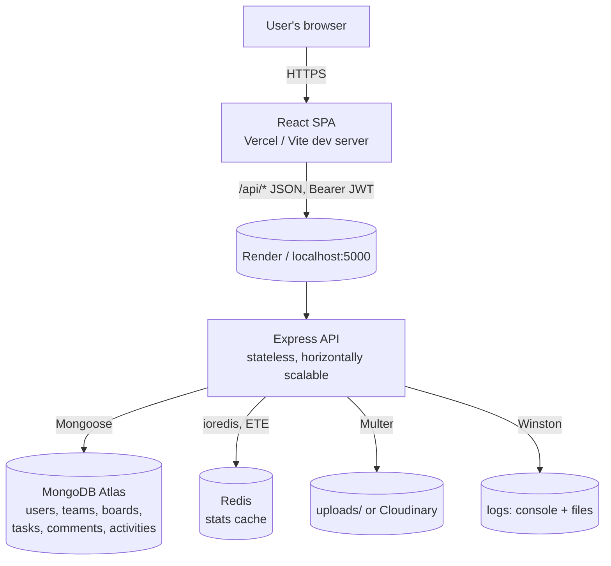

# Syncora: system design

## 1. Architecture

Syncora is a three-tier MERN application: a single-page React client, a stateless Express REST API, and MongoDB. Redis and object storage are added for the ETE.



**Why stateless:** the API keeps no session in memory. Every request carries a JWT, so any API instance can serve any request. That is what makes horizontal scaling and container restarts safe.

## 2. Backend layers (MVC-style)

```
request -> app.js (global middleware) -> routes/ -> route middleware (auth, access, validate, upload)
        -> controllers/ (HTTP in/out) -> services/ (business rules) -> models/ (Mongoose) -> MongoDB
        <- utils/ApiResponse (success shape)    errors -> middleware/errorHandler (error shape)
```

| Layer | Responsibility | Must not |
|---|---|---|
| `routes/` | Map URL + method to a middleware chain and a controller | Contain logic |
| `middleware/` | Cross-cutting checks: auth, team access, validation, upload, errors, logging | Talk to the client except to reject |
| `controllers/` | Read `req`, call a service, send the response with the right status | Write queries inline beyond trivial reads |
| `services/` | Business rules: "assignee must be a member", cascade deletes, activity logging, cache invalidation | Know about `req` or `res` |
| `models/` | Schemas, validation, indexes, hooks, virtuals, statics | Know about HTTP |
| `utils/` | `AppError`, `asyncHandler`, `ApiResponse`, `pagination`, `logger`, `cache` | Hold state |

Keeping services free of `req`/`res` lets you unit test business rules without HTTP, and is a good viva answer for "why layers".

## 3. Global middleware order (`app.js`)

Order matters: each line runs top to bottom for every request.

```js
app.use(requestId);                              // 1. attach req.id (uuid) for log correlation
app.use(helmet());                               // 2. security headers
app.use(cors({ origin: env.CLIENT_URL, credentials: true })); // 3. allow only the client origin
app.use(compression());                          // 4. gzip
app.use(express.json({ limit: '1mb' }));         // 5. JSON body parsing with a size cap
app.use(express.urlencoded({ extended: true }));
app.use(morgan('combined', { stream: logger.stream })); // 6. access log into Winston
app.use('/uploads', express.static('uploads'));  // 7. serve local attachment files
app.use('/api', routes);                         // 8. feature routes
app.use(notFound);                               // 9. 404 for unknown routes
app.use(errorHandler);                           // 10. central error handler (4 args, always last)
```

Auth routes add `authLimiter` (express-rate-limit). Mongoose is set to `mongoose.set('sanitizeFilter', true)` so `{ "$gt": "" }` in a body can't become a query operator.

## 4. Per-route middleware chain

Example: `PATCH /api/tasks/:taskId`

```
protect             -> verify JWT, load req.user (401 if missing/invalid/expired)
loadTask            -> find task by id, 404 if missing, attach req.task
requireTeamRole()   -> look up req.task.team, check req.user is a member, attach req.membership (403 if not)
validate(rules)     -> express-validator rules for the body (400 with field errors)
taskController.update
```

`requireTeamRole('owner','admin')` narrows to roles. Resource loaders (`loadTeam`, `loadBoard`, `loadTask`, `loadComment`) each resolve the team id, so a single access middleware covers every route.

## 5. Authentication and authorization

### 5.1 Authentication (who you are)

1. Register: validate, check email unique, hash password with bcrypt (cost 10), save, sign JWT.
2. Login: find user by email with `.select('+password')`, `bcrypt.compare`, sign JWT `{ sub: userId }`, `expiresIn: 7d`, `HS256`, secret from `JWT_SECRET`.
3. Each protected request: `Authorization: Bearer <token>` → `jwt.verify` → load user (exclude password) → `req.user`. Errors: missing token 401 `NO_TOKEN`, bad signature 401 `INVALID_TOKEN`, expired 401 `TOKEN_EXPIRED`, user deleted 401.

### 5.2 Authorization (what you can do): role-based access per team

| Action | Owner | Admin | Member | Non-member |
|---|---|---|---|---|
| View team, boards, tasks, comments, activity | ✅ | ✅ | ✅ | ❌ 403 |
| Edit team name or description | ✅ | ✅ | ❌ | ❌ |
| Delete team | ✅ | ❌ | ❌ | ❌ |
| Add member | ✅ | ✅ | ❌ | ❌ |
| Change a member's role | ✅ | ❌ | ❌ | ❌ |
| Remove member | ✅ (anyone but self) | ✅ (members only) | self only (leave) | ❌ |
| Create, rename, archive, delete board | ✅ | ✅ | ❌ | ❌ |
| Create task, move task, edit task | ✅ | ✅ | ✅ | ❌ |
| Delete task | ✅ | ✅ | only if creator | ❌ |
| Comment | ✅ | ✅ | ✅ | ❌ |
| Delete comment | ✅ | ✅ | only if author | ❌ |
| Upload attachment | ✅ | ✅ | ✅ | ❌ |
| Delete attachment | ✅ | ✅ | only if uploader | ❌ |

Rule of thumb: **role checks in middleware, ownership checks in the service** ("is this your comment?" needs the document).

Platform admin (`user.role === 'admin'`, optional) can call `GET /api/admin/users` and `GET /api/admin/stats`. Guarded by `restrictTo('admin')`.

### 5.3 Non-member gets 403, missing resource gets 404

A non-member asking for an existing board gets **403**. If you prefer not to reveal that a board exists, return 404 instead. Pick one and be consistent; the docs use 403 because it's easier to demo and explain.

## 6. Error handling design

- `AppError(message, statusCode, code, details)` for expected errors.
- `asyncHandler(fn)` wraps async controllers and forwards rejections to `next(err)` (not needed on Express 5).
- `errorHandler` translates known errors:

| Source | Becomes |
|---|---|
| `AppError` | its own status and code |
| express-validator result | 400 `VALIDATION_ERROR` with `details: [{ field, message }]` |
| Mongoose `ValidationError` | 400 `VALIDATION_ERROR` |
| Mongoose `CastError` (bad ObjectId) | 400 `INVALID_ID` |
| Mongo duplicate key `11000` | 409 `DUPLICATE` with the field name |
| `JsonWebTokenError` / `TokenExpiredError` | 401 `INVALID_TOKEN` / `TOKEN_EXPIRED` |
| `MulterError LIMIT_FILE_SIZE` | 413 `FILE_TOO_LARGE` |
| Multer file filter rejection | 400 `UNSUPPORTED_FILE_TYPE` |
| anything else | 500 `INTERNAL_ERROR`; stack logged, never sent in production |

Response shape is always:

```json
{ "success": false, "error": { "code": "VALIDATION_ERROR", "message": "Invalid input", "details": [ { "field": "title", "message": "Title is required" } ] }, "requestId": "6f1c..." }
```

## 7. Pagination, search and filtering

- Offset pagination: `?page=2&limit=20` → `skip = (page-1)*limit`. Response `meta: { page, limit, total, totalPages, hasNext }`.
- `limit` capped at 100; `page` minimum 1.
- Filters are whitelisted (status, priority, assignee, label, overdue, dueBefore, dueAfter); unknown query keys are ignored, never passed to Mongo.
- `q` uses the text index on title and description, sorted by `textScore`.
- `sort` is whitelisted: `createdAt`, `-createdAt`, `dueDate`, `-dueDate`, `priority`, `position`.
- `total` comes from `countDocuments` with the same filter, run in parallel with the find (`Promise.all`).

Cursor pagination (by `_id`) is the scaling upgrade; mention it as future scope.

## 8. File uploads

- Multer `diskStorage` into `server/uploads/<yyyy>/<mm>/`, filename `<uuid><ext>` (never the user's filename, to stop path tricks and overwrites).
- `limits: { fileSize: 5 * 1024 * 1024, files: 5 }`.
- `fileFilter` allows only `image/png, image/jpeg, image/webp, application/pdf, application/vnd.openxmlformats-officedocument.wordprocessingml.document, text/plain`, checked by MIME type and extension.
- Metadata saved as an embedded `attachments[]` entry on the task.
- Delete removes both the array entry and the file (`fs.promises.unlink`).
- Swap to Cloudinary storage after deploy, since Render's disk is wiped on redeploy.

## 9. Caching (ETE, unit 8)

Cache-aside on read-heavy, write-light endpoints:

| Key | Value | TTL | Invalidated by |
|---|---|---|---|
| `board:{boardId}:stats` | board stats JSON | 60 s | any task create, update, move or delete on that board |
| `team:{teamId}:dashboard` | dashboard JSON | 60 s | any task or member change in that team |

If Redis is down, the cache helper logs a warning and falls through to MongoDB, so the app keeps working.

## 10. Logging (ETE, unit 8)

- Morgan writes one access line per request into Winston's `http` level.
- Winston: console (colorized in dev), `logs/error.log` (errors only), `logs/combined.log` (all), JSON format with timestamp and `requestId`.
- Never log passwords, tokens or file contents.

## 11. Security checklist

- [ ] bcrypt hashes; `password` field `select: false`.
- [ ] JWT secret 32+ random characters, only in env.
- [ ] Helmet; CORS to `CLIENT_URL` only.
- [ ] Rate limit on `/api/auth/*`.
- [ ] express-validator on every body, param and query that reaches the DB.
- [ ] `sanitizeFilter` on; whitelisted query params.
- [ ] Multer size, count and type limits; random filenames.
- [ ] Generic login error (don't reveal whether the email exists).
- [ ] No stack traces in production; `NODE_ENV=production` set on the host.
- [ ] `.env` in `.gitignore`; `.env.example` committed.

## 12. Scalability path (for the viva and future scope)

1. Indexes for every list query (done from day one).
2. Redis cache for stats (ETE).
3. Run several stateless API containers behind a load balancer (JWT makes that work without sticky sessions).
4. Move files to object storage (Cloudinary or S3).
5. Cursor pagination for very long task lists.
6. Socket.io with the Redis adapter for live board updates.
7. Split into services only if needed: an auth service, a task service and a notification service behind an **API gateway** that verifies JWTs and routes by path, with **service discovery** (Docker Compose DNS locally, Kubernetes services in the cloud). This is the CHO unit 8 microservices topic; Syncora stays a modular monolith because one small team owns it.

## 13. Key design decisions (ADR summary)

| # | Decision | Alternatives | Reason |
|---|---|---|---|
| 1 | MongoDB with references between collections | SQL | CHO unit 5; documents fit tasks with labels and attachments |
| 2 | Embed team members in the team | Separate memberships collection | Small, bounded, always read with the team; one read for access checks |
| 3 | Store `team` on every task (denormalized) | Look up via board | One query for access checks and team-wide aggregation |
| 4 | JWT in `Authorization` header, stored in localStorage | httpOnly cookie | Simpler with a separate API domain; XSS risk mitigated by React escaping and no `dangerouslySetInnerHTML` |
| 5 | Offset pagination | Cursor | Simple page numbers in the UI; data sizes are small |
| 6 | Modular monolith | Microservices | One team, one deploy; services listed as future scope |
