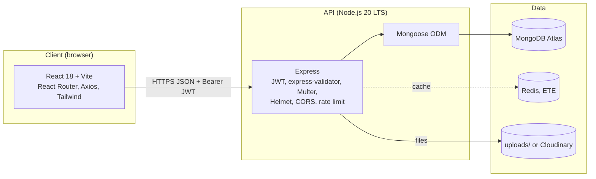

# Syncora: tech stack

Every choice below maps to a topic in the Back End Engineering-II handout (see SYLLABUS_COVERAGE.md). Install the current stable version of each package on day one and pin it in `package-lock.json`. Don't chase upgrades mid-build.

## 1. Overview



## 2. Backend (`server/`)

| Concern | Package | Why this one | CHO unit |
|---|---|---|---|
| Runtime | Node.js 20 LTS (22 also fine) | Course runtime; non-blocking I/O suits an API that mostly waits on the DB | 2 |
| Web framework | `express` (4.x) | Routing, middleware, the course's framework. 4.x matches course examples; if you use 5.x, async errors are forwarded automatically | 4 |
| ODM | `mongoose` (8.x) | Schemas, validation, populate, middleware, virtuals, statics, aggregation | 5 |
| Auth tokens | `jsonwebtoken` | Sign and verify JWTs | 4 |
| Password hashing | `bcryptjs` | Pure JS bcrypt, no native build step on Windows | 4 |
| Validation and sanitization | `express-validator` | Declarative per-route rules, sanitizers (`trim`, `escape`, `normalizeEmail`) | 4, 5 |
| File upload | `multer` (2.x) | Multipart parsing, size and type limits | 4, 7 |
| Cloud storage (optional) | `cloudinary` + `multer-storage-cloudinary` | Persistent files after deploy | 4, 8 |
| CORS | `cors` | Allow only the React origin | 7 |
| Security headers | `helmet` | Sensible HTTP headers in one line | 4 |
| Rate limiting | `express-rate-limit` | Slow brute force on `/auth` | 4 |
| Env vars | `dotenv` | Load `.env` in development | 2, 7 |
| HTTP logging | `morgan` | One line per request | 3, 8 |
| App logging | `winston` | Levels, JSON logs, files and console | 8 |
| Caching (ETE) | `ioredis` | Redis client with good TypeScript-free ergonomics | 8 |
| Compression | `compression` | gzip JSON responses | 8 |
| Dev server | `nodemon` | Restart on save | 2 |
| Tests | `jest`, `supertest`, `mongodb-memory-server` | API tests against an in-memory MongoDB | 3, 7 |
| Lint and format | `eslint`, `prettier` | ESLint is named in unit 3 | 3 |

Module system: **CommonJS** (`require`) on the server. It's what most course labs use, and Jest works without extra config. Mention in the viva that ES modules (`import`) are the alternative and why you didn't need them (CHO unit 2: "CommonJS vs ES Modules").

## 3. Frontend (`client/`)

| Concern | Package | Why | CHO unit |
|---|---|---|---|
| UI library | `react`, `react-dom` (18.x) | Components, hooks, the course's frontend library | 6 |
| Build tool | `vite` | Fast dev server; proxy `/api` to Express in development | 6, 7 |
| Routing | `react-router-dom` (6.x) | Route params, nested routes, protected routes | 6, 7 |
| HTTP | `axios` | Interceptors for the JWT header and 401 handling; upload progress events | 6, 7 |
| Styling | `tailwindcss` | Utility classes, fast responsive layout (Bootstrap is the alternative named in the CHO) | 3, 6 |
| Toasts | `react-hot-toast` | Success and error messages | 7 |
| Drag and drop (P1) | `@hello-pangea/dnd` | Maintained fork of react-beautiful-dnd for the board | 7 |
| Dates | `date-fns` | Format due dates, "2 days ago" | 6 |
| Lint | `eslint` + `eslint-plugin-react-hooks` | Catches hook mistakes | 3 |

State management: **Context API + useReducer** for auth, local `useState` for page data, and custom hooks for fetching. No Redux, since the CHO covers Context and it's enough here.

## 4. Data and infrastructure

| Concern | Choice | Notes |
|---|---|---|
| Database | MongoDB Atlas, free M0 cluster | Add your IP (or 0.0.0.0/0 for the demo) under Network Access |
| Local DB fallback | `mongo:7` Docker image | For offline demos and CI |
| Cache (ETE) | Redis 7 (Docker locally, Upstash in the cloud) | Board stats and dashboard cache |
| File storage | `server/uploads/` locally; Cloudinary after deploy | Free hosts wipe the disk on redeploy |
| Containers (ETE) | Docker, Docker Compose | `api`, `client`, `mongo`, `redis` services |
| CI (ETE) | GitHub Actions | Lint, test, build on push and pull request |
| Hosting (ETE) | API on Render or Railway; client on Vercel | You already deploy to Vercel |

## 5. Tooling

| Tool | Use |
|---|---|
| VS Code | Editor; ESLint and Prettier extensions; built-in Node debugger (CHO unit 3, debugging) |
| Git and GitHub | Repo `Syncora`; one branch per feature, pull requests into `main` |
| Postman | Collection with environments, saved tests, token auto-capture |
| MongoDB Compass | Inspect collections, indexes and `explain()` plans during the demo |
| Chrome DevTools | Network tab for CORS and JWT headers; React DevTools |

## 6. Why not other stacks (viva-ready)

| Alternative | Why not here |
|---|---|
| PostgreSQL + Prisma | Fine technically, but the CHO's CE-2 unit 5 is MongoDB and Mongoose |
| Supabase or Firebase | Hides the Express server code (routes, middleware) that the evaluation asks you to explain |
| Next.js full-stack | Blurs the client and server split the course teaches; CORS, proxy and JWT storage topics would disappear |
| Redux | Context + useReducer covers the app's state; less boilerplate to explain |
| Sessions instead of JWT | JWT keeps the API stateless and is named in the CHO; sessions need a store |

## 7. Install commands

```bash
# server
mkdir -p syncora/server && cd syncora/server
npm init -y
npm i express mongoose jsonwebtoken bcryptjs express-validator multer cors helmet express-rate-limit dotenv morgan winston compression
npm i -D nodemon jest supertest mongodb-memory-server eslint prettier
# ETE extras
npm i ioredis
# optional cloud uploads
npm i cloudinary multer-storage-cloudinary

# client
cd .. && npm create vite@latest client -- --template react
cd client
npm i react-router-dom axios react-hot-toast date-fns
npm i -D tailwindcss @tailwindcss/vite
# optional drag and drop
npm i @hello-pangea/dnd
```

Tailwind's setup steps change between major versions. Follow the current "Using Vite" guide on tailwindcss.com when you install.
